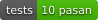
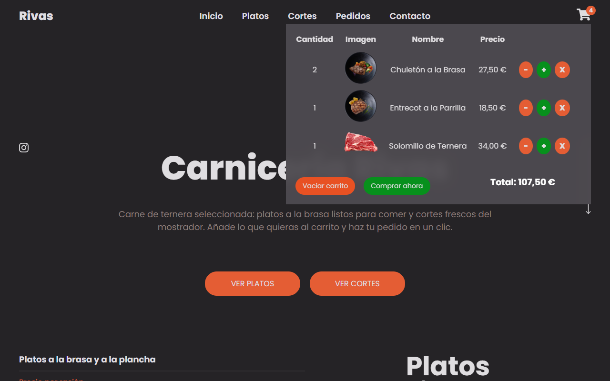
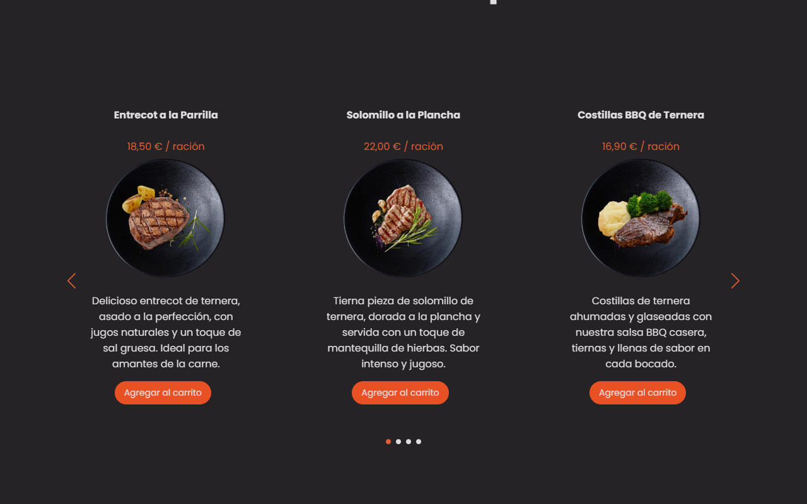
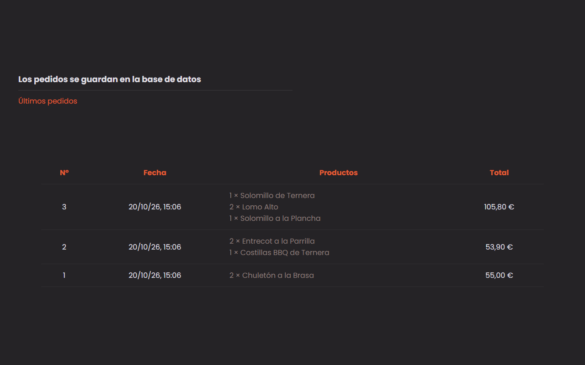
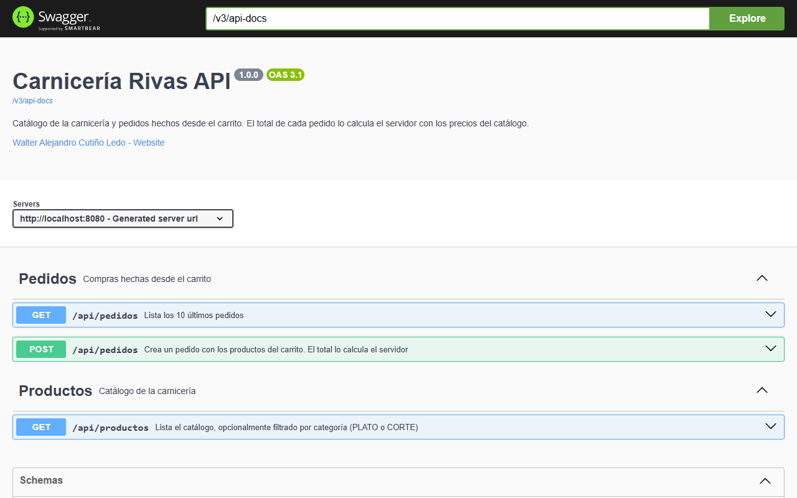

<h1 align="center">🥩 Carnicería Rivas</h1>

<p align="center">
  
  
  
  
  
</p>

**Carnicería Rivas** es la tienda web de una carnicería. Muestra el catálogo de platos a la brasa y de cortes frescos del mostrador, deja añadirlos al carrito con sus cantidades y hacer el pedido con un clic. Los pedidos se guardan en una base de datos y aparecen en la propia web. Por dentro es una **API REST en Spring Boot (Java 21)** con **SQLite**, organizada por capas, y una web en **HTML, CSS y JavaScript** que sirve la propia aplicación. El total de cada pedido lo calcula el servidor con los precios del catálogo, nunca el navegador.

<p align="center">
  
</p>

---

## Instalación

### Windows: sin instalar nada

<p align="center">
  <a href="https://github.com/walteralee/springboot-carniceria-rivas/releases/latest/download/CarniceriaRivas-Windows.zip">
    
  </a>
</p>

1. **Descarga** el ZIP con el botón de arriba.
2. **Descomprímelo** (clic derecho > *Extraer todo*).
3. Entra en la carpeta `CarniceriaRivas` y **haz doble clic** en `CarniceriaRivas.exe`. Se abre el navegador con la tienda.

> No necesitas instalar Java ni nada más: va todo dentro. Para cerrarla, cierra la ventana negra.
> Si Windows muestra *"Windows protegió su PC"*, pulsa **Más información > Ejecutar de todas formas** (sale porque el programa no está firmado).
> Para desinstalarla, borra la carpeta: no instala nada ni deja archivos en ningún otro sitio del equipo.

### Mac, Linux o Windows con Java 21

<p align="center">
  <a href="https://github.com/walteralee/springboot-carniceria-rivas/releases/latest/download/carniceria-rivas.jar">
    
  </a>
</p>

Si tienes [Java 21](https://adoptium.net) o superior, descarga el `.jar` y, en la carpeta donde lo hayas guardado, ejecuta:

```bash
java -jar carniceria-rivas.jar
```

Abre **http://localhost:8080** en el navegador. Para cerrarla, pulsa `Ctrl + C`.

### Con Docker

Con [Docker Desktop](https://www.docker.com/products/docker-desktop/) abierto:

```bash
git clone https://github.com/walteralee/springboot-carniceria-rivas.git
```

```bash
cd springboot-carniceria-rivas
```

```bash
docker compose up -d
```

Abre **http://localhost:8080**. Para apagarla: `docker compose down`. Los pedidos se guardan en un volumen de Docker.

---

## Funcionalidades

- **Catálogo** de 4 platos (precio por ración) y 4 cortes (precio por kilo), guardado en la base de datos y cargado por la web desde la API.
- **Carrito** con cantidades: añadir, sumar, restar, quitar y vaciar. Muestra el total y se mantiene aunque recargues la página.
- **Pedidos**: al pulsar *Comprar ahora* se guarda el pedido con sus líneas. El servidor:
  - comprueba que los productos existen,
  - junta las líneas repetidas,
  - limita la cantidad a 99 unidades por producto,
  - calcula el total con los precios del catálogo (ignora cualquier precio que envíe el navegador).
- **Últimos pedidos**: la web muestra los 10 pedidos más recientes con su fecha, productos y total.
- **Errores claros** en JSON (`{ "message": "..." }`) con su código HTTP: 400 si la petición no es válida y 404 si un producto no existe.
- **Swagger** en `/swagger-ui.html` para probar la API desde el navegador.

<p align="center">
  
  &nbsp;
  
</p>

## Tecnologías

| | |
|---|---|
| Backend | Java 21 · Spring Boot 3.5 (Spring Web, Spring Data JPA, Bean Validation) |
| Base de datos | SQLite con Hibernate (se crea sola con el catálogo inicial) |
| Frontend | HTML, CSS y JavaScript (sin frameworks) con el carrusel Swiper |
| Documentación de la API | Swagger / OpenAPI (springdoc) |
| Tests | JUnit 5 + MockMvc (10 tests de integración con una base de datos temporal) |
| Despliegue | Ejecutable de Windows con Java incluido (jpackage), `.jar` y Docker |

## API

| Método | Ruta | Qué hace |
|---|---|---|
| GET | `/api/productos` | Lista el catálogo |
| GET | `/api/productos?categoria=PLATO\|CORTE` | Lista solo los platos o solo los cortes |
| POST | `/api/pedidos` | Crea un pedido: `{ "lineas": [ { "productoId": 1, "cantidad": 2 } ] }` |
| GET | `/api/pedidos` | Lista los 10 últimos pedidos con sus líneas |

<p align="center">
  
</p>

## Ejecutar desde el código

Solo si quieres ver o modificar el código. Necesitas [Java 21](https://adoptium.net) o superior; Maven no hace falta, va incluido (`mvnw`).

- **Windows:** doble clic en **`run.bat`**.
- **Mac / Linux:** `./run.sh`

Compila, arranca y abre el navegador en **http://localhost:8080**. La base de datos se crea en la carpeta `datos/`. También puedes abrir el proyecto en IntelliJ IDEA o VS Code y ejecutar `CarniceriaRivasApplication`.

**Tests:**

```bash
./mvnw test
```

**Generar la versión de Windows** (queda en `dist/`; necesita un JDK 21 con `jpackage`):

```bash
powershell -ExecutionPolicy Bypass -File scripts/publicar-windows.ps1
```

## Arquitectura

El backend está organizado **por capas**: cada una solo habla con la de debajo.

```text
Petición HTTP
   │
   ▼
controlador   recibe la petición, valida el JSON (@Valid) y responde
   │
   ▼
servicio      reglas de la tienda: productos existentes, cantidades y cálculo del total
   │
   ▼
repositorio   acceso a la base de datos con Spring Data JPA
   │
   ▼
SQLite        tablas producto, pedido y linea_pedido
```

Los errores se lanzan como excepciones (`PeticionNoValida` → 400, `RecursoNoEncontrado` → 404) y un único `ManejadorErrores` los convierte en JSON. La API usa **DTO** (`dto/`) para no exponer las entidades. En el frontend, `api.js` solo hace peticiones y `app.js` solo maneja la pantalla.

## Estructura

```text
run.bat · run.sh                       arrancar desde el código
pom.xml · mvnw                         proyecto Maven (Maven incluido)
src/main/java/com/carniceriarivas/
├── CarniceriaRivasApplication.java    arranque
├── controlador/                       ProductoControlador y PedidoControlador: endpoints HTTP
├── servicio/                          CatalogoServicio y PedidoServicio: reglas de la tienda
├── repositorio/                       ProductoRepositorio y PedidoRepositorio (Spring Data JPA)
├── modelo/                            Producto, Pedido, LineaPedido y Categoria (entidades)
├── dto/                               lo que entra y sale de la API
├── error/                             errores y manejador global
└── config/                            catálogo inicial, carpeta de datos, Swagger y apertura del navegador
src/main/resources/
├── application.properties             configuración
└── static/                            web: index.html, css/, js/ (api.js y app.js) e imagenes/
src/test/                              tests de integración de la API
scripts/publicar-windows.ps1           genera el ZIP de Windows y el .jar
Dockerfile · docker-compose.yml        versión con Docker
datos/                                 base de datos SQLite (se crea sola, no se sube a Git)
```

## Autor

**Walter Alejandro Cutiño Ledo** · [github.com/walteralee](https://github.com/walteralee)

---

## English

**Carnicería Rivas** is the web shop of a butcher's: browse grilled dishes and fresh cuts, add them to the cart with quantities and place an order in one click. Orders are stored in a database and listed on the page. Built with a layered **Spring Boot (Java 21) REST API**, **SQLite** and an **HTML/CSS/JavaScript** frontend. The order total is always calculated by the server from catalogue prices.

**Install:**

- **Windows (nothing to install):** download **[CarniceriaRivas-Windows.zip](https://github.com/walteralee/springboot-carniceria-rivas/releases/latest/download/CarniceriaRivas-Windows.zip)**, unzip it and double-click `CarniceriaRivas/CarniceriaRivas.exe`. The browser opens by itself.
- **With Java 21 (any OS):** download **[carniceria-rivas.jar](https://github.com/walteralee/springboot-carniceria-rivas/releases/latest/download/carniceria-rivas.jar)**, run `java -jar carniceria-rivas.jar` and open http://localhost:8080.
- **Docker:** `git clone` the repo, run `docker compose up -d` and open http://localhost:8080.

**From source:** `run.bat` (Windows) or `./run.sh` (Mac/Linux) with Java 21. Tests: `./mvnw test`. API docs at `/swagger-ui.html`.
**Author:** Walter Alejandro Cutiño Ledo · [github.com/walteralee](https://github.com/walteralee)
